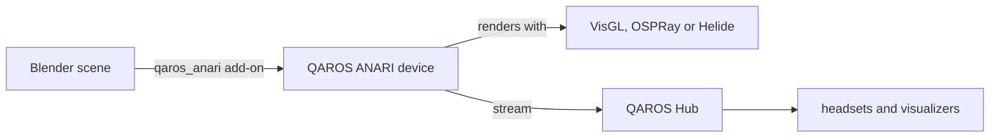

# QAROS for Blender

The **QAROS ANARI Streaming** add-on streams the scene open in Blender into a QAROS app volume, live,
to every headset and visualizer in the session. Keep working in Blender: moved objects, edited meshes
and changed materials show up in the room within a moment. A controls panel in the headset edits the
active object, and pointing into the volume selects and moves objects.

## Requirements

- Windows, Blender 4.5 LTS or newer.
- [QAROS](https://docs.quaternar.com/docs/operator-guide/installation) installed with the **ANARI
  device** component (`/ANARI`); optionally the **OSPRay backend (CPU)** component (`/OSPRay`).

## Install

1. Download `qaros_anari.zip` from [Releases](https://github.com/Quaternar/qaros-blender/releases).
2. Blender: **Edit → Preferences → Add-ons → Install from Disk**, pick the ZIP, enable
   **QAROS ANARI Streaming**.
3. 3D View sidebar (`N`) → **QAROS** tab → **Start streaming**. Allow Blender in QAROS the first time.

## Documentation

| Page | For |
|---|---|
| [User guide](docs/user-guide.md) | setup, app volume, backends, preferences, materials, troubleshooting, limits |
| [Developing](docs/DEVELOPING.md) | how the add-on works, repository layout, tests, building the ZIP, releasing |
| [Changelog](CHANGELOG.md) | changes per version |

QAROS itself is documented at [docs.quaternar.com](https://docs.quaternar.com).

## Licence

MIT, see [LICENSE](LICENSE).
