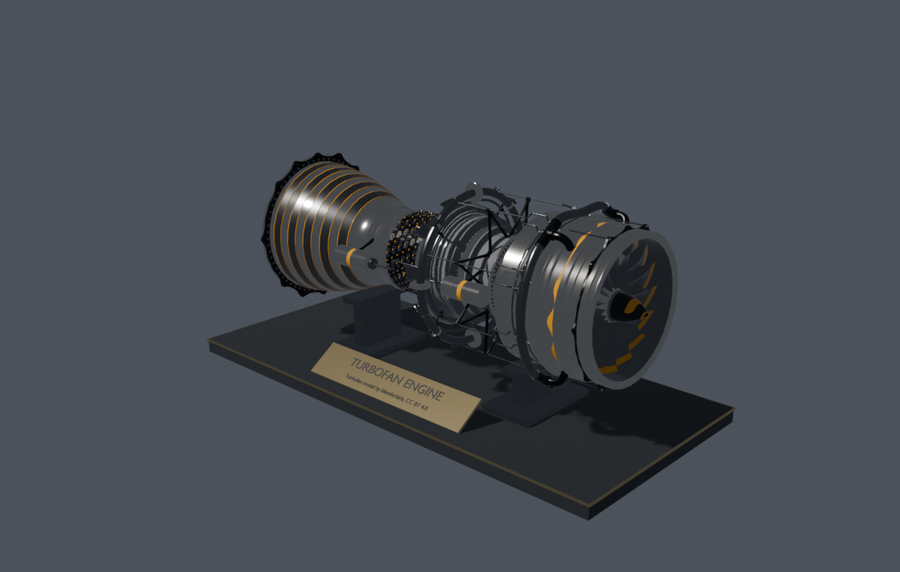
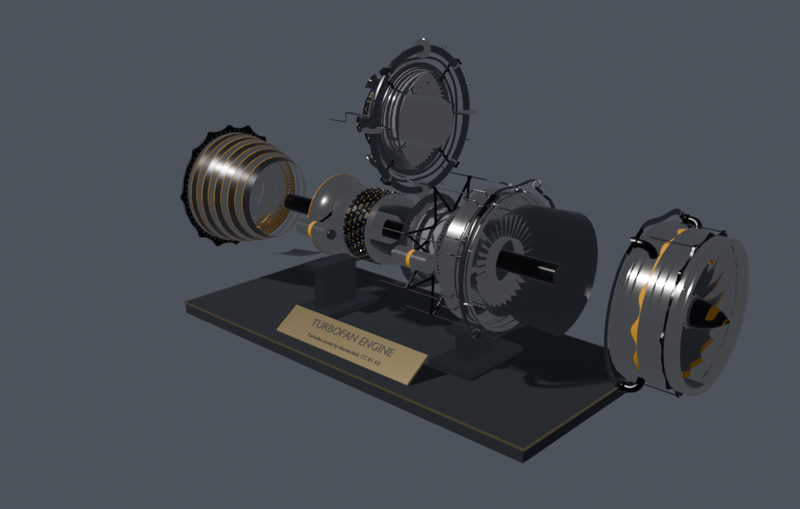

# Turbofan engine: Blender + ANARI demo

A detailed turbofan jet engine on a display stand, streamed live from Blender to the QAROS
Visualizer and to headsets, rendered by the **VisGL** ANARI backend (GPU raster: fast, lit, with
shadows). A **Blender** controls panel floats beside it for every user. The engine is split into its
sections, so people pull it apart by hand in the headset while Blender follows, and the presenter
edits it in Blender while everyone watches.





| What the audience sees | What it shows |
|---|---|
| A turbofan with its fan, compressor stages, combustion chamber, turbine and exhaust, on a stand that turns slowly | a 236,000-triangle model streamed into a shared app volume, from any viewpoint, for every user at once |
| A section pulled out of the engine by hand | pointing selects a Blender object; a one-hand drag moves it, and Blender's scene follows |
| The **Blender** panel beside the engine | edits from the headset: move or turn a section, change a material's colour, pause the turntable, undo |
| The presenter editing in Blender | any change made in Blender (moving, recolouring, cutting, sculpting) shows in the room within a moment |

VisGL renders a frame in about 7 ms, so the stream holds its 30 fps per user with room to spare.

The engine is "Turbine | Turbofan Engine | Jet Engine" by
[blenderbirb](https://sketchfab.com/blenderbirb), [CC BY 4.0](https://creativecommons.org/licenses/by/4.0/)
([source](https://sketchfab.com/3d-models/turbine-turbofan-engine-jet-engine-74c6aceed86b4a41aaad3b93afc3e262)).
The credit is on the stand's plaque; keep it when you show or share the demo
([assets/CREDITS.md](assets/CREDITS.md)).

## Files

| File | What it is |
|---|---|
| `start_demo.py` | starts everything in Blender: builds the scene, add-on on, VisGL, **Start streaming**, fit to the volume, play |
| `build_demo_scene.py` | builds the scene from the model: six engine sections, the stand, the plaque, the turntable (about 4 s) |
| `assets/turbofan.glb` | the engine model as published, with `assets/CREDITS.md` |
| `turbofan.png`, `turbofan_exploded.png` | the pictures above |

## What you need

| | Needed |
|---|---|
| PC | Windows, GPU with OpenGL 4.3 (any recent NVIDIA, AMD or Intel GPU) |
| QAROS | a build or release with **served GUI panels** for the controls panel (today: branch `feat/anari-blender-served-panel` or `staging/main-with-headset` of Quaternar; QAROS 0.9.0 streams the engine but shows no panel) and the **ANARI device** |
| Blender | 4.5 LTS or newer (checked with 5.2) |
| Add-on | **QAROS ANARI Streaming** from this repository: installed in Blender, or the checkout's `blender` folder passed with `--addon-dir` |
| Headset (optional) | paired with this QAROS; see [Pair a headset](https://docs.quaternar.com/docs/operator-guide/visualizer-tutorials/pair-a-headset) |

## Start it

Pick the way that matches your QAROS.

### A: QAROS installed (setup)

1. Install the add-on once: build its ZIP in this repository (`python tools/build_zip.py`, writes
   `dist/qaros_anari.zip`) or download `qaros_anari-<version>.zip` from the
   [Releases](https://github.com/Quaternar/qaros-blender/releases), then in Blender **Edit →
   Preferences → Add-ons → Install from Disk**, pick the ZIP and enable **QAROS ANARI Streaming**.
   Leave **ANARI folder** empty.
2. Start **QAROS** (Start menu). The Visualizer opens.
3. Start the demo from a terminal in this repository:

   ```powershell
   & "C:\Program Files\Blender Foundation\Blender 5.2\blender.exe" --python demo\start_demo.py
   ```

4. The first time only, QAROS asks **"Allow Blender to join QAROS?"**: click **Allow**.
5. Within about ten seconds the engine appears in the Visualizer with the **Blender** panel beside
   it, and the stand starts turning.

### B: QAROS from a build (developer PC)

Start Blender **from the Visualizer**, so it joins that build's hub and no other.

1. Start `qaros.exe` from the build's launcher folder, for example
   `Quaternar\build\windows-x64-relWithDebInfo\qar-runtime-launcher\qaros.exe`. Never start the
   Visualizer or the launcher on their own.
2. In the Visualizer: **Settings → UI mode → Developer**, then **Sources → + (Add source app) →
   QAROS API app**:
   - **Name:** `Blender demo`
   - **Executable:** `C:\Program Files\Blender Foundation\Blender 5.2\blender.exe`
   - **Arguments**, one per line (adjust the paths to your checkouts):

     ```text
     --python
     C:\Repos\qaros-blender\demo\start_demo.py
     --
     --addon-dir
     C:\Repos\qaros-blender\blender
     --anari-folder
     C:\Repos\Quaternar\build\windows-x64-relWithDebInfo\qar-runtime-launcher
     ```

   - **Add**.
3. Click **Launch** on the **Blender demo** tile. The first time only, allow Blender on the
   approval card under **Sources**.
4. The engine appears with the **Blender** panel, and the stand starts turning.

**Stop** on the tile quits that Blender at once (it keeps the session in `quit.blend`; the model in
`assets` is never changed).

### Headset

Pair the headset with this QAROS before the demo ([Pair a headset](https://docs.quaternar.com/docs/operator-guide/visualizer-tutorials/pair-a-headset)).
The engine and its panel appear in the shared space for every paired user; up to two users are
streamed at once (add-on preference **Users**).

## During the demo

| Do | Where | Result |
|---|---|---|
| Walk around, lean in | headset | the engine stays put in the room; look through the open casing at the stages |
| **Frame** tab → **Pause** | panel | the turntable stops (do this before pulling sections out) |
| Point at a section (the fan at the front, the exhaust at the back), click | headset or Visualizer | it is selected in Blender too; the panel shows its name |
| One-hand drag after the click | headset or Visualizer | pulls that section out of the engine: an exploded view by hand |
| **Object** tab → Location, Rotation | panel | moves or turns the selected section precisely |
| **Material** tab | panel | changes the colour, roughness or metallic of the selected section's material |
| **Undo** / **Redo** | panel, top right | puts sections back, step by step |
| Click empty space | headset | the one-hand drag moves the whole engine again |
| Two-hand pinch and pull | headset | scales and turns the whole engine |
| Edit in Blender: recolour a material, add a **Boolean** cut-away, move a section | Blender | the change shows in the room within a moment |

The sections are **Fan**, **Compressor**, **Combustion chamber**, **Turbine**, **Exhaust** and
**Frame and shaft**. With the Visualizer's simulated hand, aim at the upper part of a section: its
pointing ray runs a little below the mouse.

## If something is off

| Symptom | Fix |
|---|---|
| The QAROS tab in Blender shows **Backend:** other than VisGL | another backend was loaded first: quit Blender and start the demo again (`start_demo.py` chooses VisGL) |
| Nothing appears, the status waits for approval | allow Blender in QAROS (tray prompt, or the approval card under **Sources**) |
| The engine is tiny or too large | **Fit scene to volume** in Blender's QAROS tab (`N` sidebar) |
| No **Blender** panel | this QAROS has no served GUI panels (QAROS 0.9.0): the engine still streams |
| The panel says "Page not available" | Blender stopped or crashed: start the demo again, the panel comes back |
| The stream is slow and every CPU core is busy | the scene runs on a CPU backend: see the first row |

`start_demo.py` prints each step with a `[qaros-demo]` prefix (Blender's console, or the launcher log
of the tile), so a failed start says where it stopped. The scene is always built in metres,
whatever units your Blender startup file uses.

## Options

`start_demo.py` takes options after `--`:

| Option | Default | |
|---|---|---|
| `--backend NAME` | `visgl` | `visrtx` (NVIDIA RTX, ray traced, slower), `ospray`, `helide`, `automatic` |
| `--addon-dir DIR` | the installed add-on | a checkout's `blender` folder |
| `--anari-folder DIR` | the add-on's preference | folder with `anari.dll` and `anari_library_qaros.dll` |
| `--no-fit` | fit | keep the app volume's placement |
| `--no-play` | play | leave the turntable still |

To keep your own edits, save the scene in Blender (**File → Save As**) and start with it instead:
`blender my_demo.blend --python demo\start_demo.py`. With a `.blend` on the command line,
`start_demo.py` uses it and builds nothing.

## Rebuild or tune the scene

The sections are cut along the engine axis at the positions in `SECTIONS` at the top of
`build_demo_scene.py`. To save the built scene as a `.blend`:

```powershell
& "C:\Program Files\Blender Foundation\Blender 5.2\blender.exe" -b --factory-startup --python demo\build_demo_scene.py -- --save demo\turbofan.blend
```
