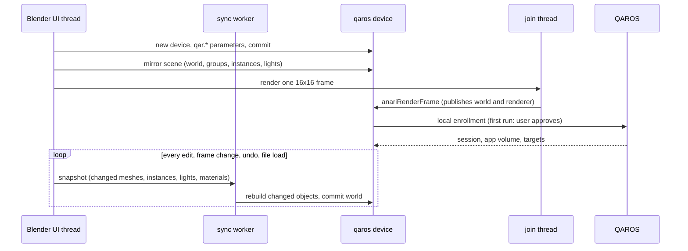

# Developing the add-on

## Layout

| Path | Holds |
|---|---|
| `blender/qaros_anari/` | the add-on: the ZIP is this folder |
| `blender/qaros_anari/panel/` | the controls panel page (HTML, CSS, JS) served to headsets |
| `tests/` | unit tests (plain Python), Blender tests (background mode), device tests |
| `tests/usd/` | USD scenes for the USD tests |
| `tools/run_tests.py` | runs the tests, see [Tests](#tests) |
| `tools/build_zip.py` | writes `dist/qaros_blender_anari.zip` |
| `tools/package_release.py` | checks `VERSION` against `bl_info["version"]`; writes the release assets |
| `VERSION` | the next planned release `X.Y.Z`, equal to `bl_info["version"]` |
| `.github/workflows/release.yml` | packages every pull request, publishes a release on a `v*` tag |
| `tools/blender_material_validation.py` | live material reference scene for checking a backend by eye |
| `tools/prepare_blender_addon.py` | adds `qaros` to the library list of Khronos's `CustomAnariRender.py` render engine |

## Dependencies on QAROS

The add-on ships no native code. It loads, through `ctypes`:

| Library | From | Used for |
|---|---|---|
| `anari.dll`, `anari_library_qaros.dll` | **ANARI folder**, else `QAR_ANARI_FOLDER` (set by the QAROS that started Blender), else the first `PATH` entry holding both (the QAROS setup's `anari\`) | the scene: device, objects, materials, lights, `qar.*` parameters |
| the QAR runtime (`qar-streaming-c`) | the path the device reports (`qar.runtimeLibrary`) | controls panel, gestures, on the device's own session |

- The C structures in `panel.py` and `pointing.py` follow the public C API header
  `qar_streaming.h` ([qaros](https://github.com/Quaternar/qaros)). That API only grows, so an add-on
  works with every newer QAROS; a feature the installed QAROS lacks is reported and left out.
- `qar.*` device parameters and backends are documented with the device in QAROS.

## How it works



- **Not a render engine.** Blender frees a viewport engine on Solid shading or a closed 3D view.
  The add-on owns one device from Start to Stop and mirrors the scene from depsgraph handlers.
- **Publish once.** The device streams the world of the app's last rendered frame, so the add-on
  renders one small frame; later edits commit on the same world.
- **No ANARI calls on the UI thread.** The UI thread reads the depsgraph into numpy snapshots
  (`SceneCapture`); one worker applies them (`SceneMirror`, `SyncWorker`). A waiting snapshot
  absorbs the next, so a drag sends the latest transforms.
- **Incremental.** Only changed objects are rebuilt; moved instances get a new transform in place.
- **Batching.** Static parts of one material are merged into chunks; a moving object leaves its
  chunk and rejoins after 2 s still.
- **Culling.** Objects entirely outside the app volume (`qar.volumeCube`) are left out.
- **Lights** stream in the units Cycles renders them with; a scene without lights gets a sun.
- **World** (`world.py`): the World's equirectangular Environment Texture or plain colour, with
  strength and Mapping rotation, copied on the UI thread (pixels read once per image, averaged
  down to 1024 columns) and sent as an `hdri` light with `visible` off, only when the device
  advertises an hdri light with `radiance` and `visible` (`Device.environment_support`) and the
  renderer is not OSPRay's SciVis. VisGL has none (`anariNewLight("hdri")` returns null there);
  VisRTX 26.09 does not advertise `visible`, and with it off lights nothing and turns matte
  surfaces to grain; SciVis ignores hdri lights.
- **Backend order:** Automatic sets `QAR_ANARI_BACKEND_ORDER=visgl,visrtx,ospray,helide` before
  the library loads (kept when already set); a qaros without that variable keeps its own order.
- **Materials:** constant inputs of the active Principled BSDF (`materials.py`); the device's
  advertised capabilities decide what each backend gets.
- **Controls panel** (`panel.py`, `controls.py`, `protocol.py`, `blender_panels.py`): the page is
  served over the device's session. Edits are queued per control on the QAR thread and applied by
  the UI thread every 50 ms, latest value first; a released drag is one undo step. The panel keeps
  its id across runs (common name per app volume). A panel an earlier run left open (Blender
  crashed, or the hub restarted under it) is taken over by `get_or_create`, which keeps its place
  and points it at this run's bundle; a runtime from before that rule leaves such a panel on the
  earlier run's bundle, shown as "Page not available".
- **Pointing** (`pointing.py`): a click selects by Blender's ray cast. The ray cast reports a
  collection instance as its prototype; the pick maps it to the instancing object through the
  depsgraph's instances (matched by matrix), so a drag never moves the prototype inside every
  instance.
- **View, not model:** the app pose and app scale (gestures, the Visualizer's Content mode,
  `qar.fitBox`) are a camera transform: the device renders each eye in app content space, so the
  add-on never writes a Blender object for them. Only a one-hand drag that grabbed the user's
  selection moves it: the user is in the object mode (one-hand drag reported, not mapped) only
  while their latest hover picks their selection (`Controls.follow_hovers`, one ray cast per new
  hover, never during their drag), and a drag in that mode moves the object only when its own
  hit, else the hand's latest hover, picks the selection (`Controls.aimed`). A pinch on a GUI panel
  or on empty space reaches the volume without a hit and moves nothing.
- **Streams to** (`targets.py`): the device reports the session's target applications in
  `qar.sessionTargets` (JSON) and streams to the peer ids in `qar.targets` (unset: every one). The
  tab reads the list at most every 0.5 s (panels redraw on every mouse move), and the 1 s redraw
  timer keeps the chosen devices' names in the scene, so one that leaves is still listed by name.
  The choice is two Scene properties, `qaros_stream_to_all` and `qaros_stream_targets` (JSON peer id
  -> name), so it is saved with the `.blend` like `qaros_volume_name`: a scene's audience goes with
  the scene. A change commits the device at once; a loaded `.blend`, an undo or a scene switch
  applies that scene's choice. `qar.targets` is set only for a selection, so an older device never
  sees it.
- **Stop from QAROS** (`hub_launch.py`): a QAROS launcher stops an app by closing its stdin, asking
  it to close and terminating it one second later. When QAROS started Blender (`QAR_INSTANCE` set,
  stdin a pipe), the add-on watches stdin and quits Blender at once; Blender writes `quit.blend`
  first. A Blender started by hand never quits on its own.
- **Start from the Blender tile** (`hub_launch.py`): the QAROS Visualizer's Blender tile starts
  Blender with `--addons qaros_anari` and `QAR_BLENDER_AUTO_START=1`. The add-on then presses
  **Start streaming** once, 0.5 s after it registered (a persistent timer, so a `.blend` named on the
  command line is loaded first). `1`, `true`, `on`, `yes` (any case) switch it on; `0`, `false`,
  `off`, `no` or unset leave it off; any other text is off with a warning in the console. A failed
  Start is not repeated, and a Start the user pressed first is not doubled.
- **Preferences under `--addons`**: `--addons` enables the add-on for the session without adding it
  to Blender's preferences, so a Blender whose preferences never enabled it has no entry for it.
  `preferences()` then answers the declared defaults (`hub_launch.preference_defaults`), kept for
  the session, and never writes the add-on into the user's preferences.

## Developing against a hub from a QAROS build

Start Blender from that hub's Visualizer (**Sources → + Add source app → QAROS API app**,
`blender.exe`), never by hand. Its launcher hands Blender the hub's `QAR_INSTANCE`, so the add-on
joins that hub. A Blender started by hand finds and starts the installed QAROS instead.

Point **ANARI folder** at the build's device output folder to test a device build.

## Tests

```powershell
python tools/run_tests.py                                   # every group whose needs are met
python tools/run_tests.py --group unit                      # plain Python only
python tools/run_tests.py --anari-folder <build>\qar-anari-device\bin --backend visgl
```

- `unit` runs everywhere. `blender` needs Blender (`--blender`, else `QAR_TEST_BLENDER_EXECUTABLE`,
  else `PATH`, else Program Files). `device` also needs a device folder: the installed QAROS's
  `anari` folder by default.
- Device tests run with streaming off (`QAR_ANARI_STREAM=0`) on `--backend` (default `helide`). A
  test exits 77 (skipped) when the backend cannot run on this PC, for example VisGL without
  hardware OpenGL.
- `test_blender_usd_scene.py` renders `tests/usd/usd_scene.usda` and checks each object by the colour
  where it lands, so a lost material, opacity, instance or light shows as a wrong pixel.
- `test_blender_addon_sync.py SceneSyncTests.<method>` runs one material case.

## Releasing

The add-on is released like the other QAROS apps (qaros-rerun, qaros-ros-rviz): a GitHub release
per version with the add-on ZIP and a `manifest.json`. The QAROS Visualizer's Blender tile reads
`releases/latest/download/manifest.json` and downloads the latest add-on from it.

### Versions

- [`VERSION`](../VERSION) holds the next planned version `X.Y.Z`. Blender needs a literal
  `bl_info["version"]` in `blender/qaros_anari/__init__.py`: keep it equal to `VERSION`. CI
  (`tools/package_release.py --check`) fails when they differ.
- Release tags are the add-on's own version, not the QAROS version: `vX.Y.Z`, or `vX.Y.Z-rc.N` for
  a candidate (published as a GitHub pre-release). A tag whose `X.Y.Z` differs from `VERSION`
  fails the release. A pull request is packaged as `X.Y.Z-pr.<number>` and never published.
- Semantic versioning: a minor version adds features, a patch version only fixes. Tags go on
  `main`; there are no release branches.
- This repository follows the shared QAROS versioning scheme: [ADR-0001: One versioning scheme for every QAROS repository](https://github.com/Quaternar/qaros/blob/main/docs/adr/0001-one-versioning-scheme.md).

### Release assets

| Asset | What it is |
|---|---|
| `qaros_blender_anari-<version>.zip` | the folder `qaros_anari/` at the root: the ZIP Blender's **Install from Disk** takes |
| `manifest.json` | the release, for the Visualizer's Blender tile |

```json
{
  "version": 1,
  "release": "0.4.0",
  "package": "qaros-blender",
  "assets": [
    {
      "name": "qaros_blender_anari-0.4.0.zip",
      "sha256": "<64 lower-case hex digits>",
      "size": 123456,
      "platform": "any",
      "app_version": "0.4.0",
      "min_qaros_version": "0.9.0",
      "min_blender_version": "4.5.0",
      "addon_module": "qaros_anari"
    }
  ]
}
```

- `version` is the manifest format, `release` the add-on version, `package` always `qaros-blender`.
- `platform` is `any`: the add-on is pure Python and loads QAROS's own ANARI device.
- `min_qaros_version` is `MIN_QAROS_VERSION` in `tools/package_release.py`, the oldest QAROS the
  add-on streams with; `min_blender_version` is `bl_info["blender"]`; `addon_module` is the name
  Blender enables (`--addons qaros_anari`).
- `python tools/package_release.py --out-dir dist/release` writes both locally.

### Release `X.Y.Z`

1. Optional candidate: tag the commit to test `vX.Y.Z-rc.N` on `main` and push the tag.
2. Release commit: move the entries of `## [Unreleased]` in `CHANGELOG.md` under
   `## [X.Y.Z] - YYYY-MM-DD` and leave an empty `## [Unreleased]` above it.
3. Tag that commit `vX.Y.Z` on `main` and push the tag. `release.yml` runs the unit tests, builds
   the ZIP and `manifest.json` and attaches them to the GitHub release `vX.Y.Z`.
4. Bump: in the next commit set `VERSION` and `bl_info["version"]` to the next planned version
   (`X.(Y+1).0`), never in the tagged commit.

## Commits

- Subject `area: what changed` (Conventional Commits), body terse bullets.
- A user-visible change gets its `Unreleased` entry in `CHANGELOG.md` in the same commit.
