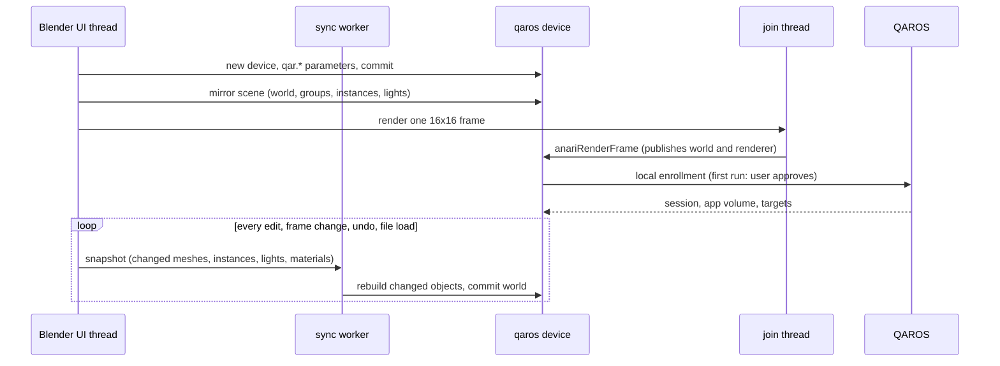

# Developing the add-on

## Layout

| Path | Holds |
|---|---|
| `blender/qaros_anari/` | the add-on: the ZIP is this folder |
| `blender/qaros_anari/panel/` | the controls panel page (HTML, CSS, JS) served to headsets |
| `tests/` | unit tests (plain Python), Blender tests (background mode), device tests |
| `tests/usd/` | USD scenes for the USD tests |
| `tools/run_tests.py` | runs the tests, see [Tests](#tests) |
| `tools/build_zip.py` | writes `dist/qaros_blender_anari.zip` |
| `tools/package_release.py` | checks `VERSION` against `bl_info["version"]`; writes the release assets |
| `VERSION` | the last release `X.Y.Z`, equal to `bl_info["version"]` |
| `.github/workflows/release.yml` | packages every pull request, publishes a release on a `v*` tag |
| `.github/workflows/app-release.yml`, `.github/app-release.json` | releases every merge that changes behaviour, see [Releasing](#releasing) |
| `tools/blender_material_validation.py` | live material reference scene for checking a backend by eye |
| `tools/prepare_blender_addon.py` | adds `qaros` to the library list of Khronos's `CustomAnariRender.py` render engine |

## Dependencies on QAROS

The add-on ships no native code. It loads, through `ctypes`:

| Library | From | Used for |
|---|---|---|
| `anari.dll`, `anari_library_qaros.dll` | **ANARI folder**, else `QAR_ANARI_FOLDER` (set by the QAROS that started Blender), else the first `PATH` entry holding both (the QAROS setup's `anari\`) | the scene: device, objects, materials, lights, `qar.*` parameters |
| the QAR runtime (`qar-streaming-c`) | the path the device reports (`qar.runtimeLibrary`) | controls panel, gestures, on the device's own session |

- The C structures in `panel.py` and `pointing.py` follow the public C API header
  `qar_streaming.h` ([qaros](https://github.com/Quaternar/qaros)). That API only grows, so an add-on
  works with every newer QAROS; a feature the installed QAROS lacks is reported and left out.
- `qar.*` device parameters and backends are documented with the device in QAROS.

## How it works



- **Not a render engine.** Blender frees a viewport engine on Solid shading or a closed 3D view.
  The add-on owns one device from Start to Stop and mirrors the scene from depsgraph handlers.
- **Publish once.** The device streams the world of the app's last rendered frame, so the add-on
  renders one small frame; later edits commit on the same world.
- **No ANARI calls on the UI thread.** The UI thread reads the depsgraph into numpy snapshots
  (`SceneCapture`); one worker applies them (`SceneMirror`, `SyncWorker`). A waiting snapshot
  absorbs the next, so a drag sends the latest transforms.
- **Incremental.** Only changed objects are rebuilt; moved instances get a new transform in place.
- **Batching.** Static parts of one material are merged into chunks; a moving object leaves its
  chunk and rejoins after 2 s still.
- **Culling.** Objects entirely outside the app volume (`qar.volumeCube`) are left out.
- **Lights** stream in the units Cycles renders them with; a scene without lights gets a sun.
- **World** (`world.py`): the World's equirectangular Environment Texture or plain colour, with
  strength and Mapping rotation, copied on the UI thread (pixels read once per image, averaged
  down to 1024 columns) and sent as an `hdri` light with `visible` off, only when the device
  advertises an hdri light with `radiance` and `visible` (`Device.environment_support`) and the
  renderer is not OSPRay's SciVis. VisGL has none (`anariNewLight("hdri")` returns null there);
  VisRTX 26.09 does not advertise `visible`, and with it off lights nothing and turns matte
  surfaces to grain; SciVis ignores hdri lights.
- **Backend order:** Automatic sets `QAR_ANARI_BACKEND_ORDER=visgl,visrtx,ospray,helide` before
  the library loads (kept when already set); a qaros without that variable keeps its own order.
- **Renderer switch** (`Streamer.load_library`, `QAROS_OT_set_backend`): qaros chooses its backend
  when its library loads (`QAR_ANARI_BACKEND`, else the order) and never unloads, so each Renderer
  choice loads `qaros` once more (`anariLoadLibrary`, a library of its own with its own backend)
  and keeps it in `Streamer.libraries`. Every load uses the first load's ANARI folder: a second
  `anari.dll` would be a second ANARI runtime in the process. A Renderer chosen while streaming
  restarts the stream (`Streamer.restart`: stop with wait, start), except while the first render
  still joins QAROS; the Renderer panel then offers the restart. Switching backends in one process
  was checked with every shipped backend (VisGL, VisRTX, OSPRay, Helide) in any order, each device
  having rendered a frame (a VisGL device released before its first frame crashes the process).
- **Shading** (`shading.py`): the stream follows the largest 3D viewport's shading, or a fixed
  choice (`WindowManager.qaros_shading`), polled every 0.25 s while streaming (`watch_shading`: a
  shading change sends no depsgraph update). A change is a full capture in the new
  `SceneCapture.shading`:
  - Wireframe captures each mesh's edges (`sync.mesh_wire`) as one part whose indices are pairs;
    `SceneMirror.build_group` makes a `cylinder` geometry of it (every shipped backend has one;
    ANARI has no line primitive) with a radius of a thousandth of the scene's diagonal, divided by
    the instance's scale; merged chunks bake the transform, so they take the radius as is.
  - Solid replaces each material description with a matte one in the viewport colour
    (`shading.shaded_description`); Wireframe with one light grey matte material (`WIRE_KEY`).
  - Solid and Wireframe drop the scene's lamps and World, so the studio light lights them; Material
    Preview and Rendered follow the viewport's Scene Lights and Scene World options.
- **Stream to QAROS** (`Object.qaros_stream`): the capture leaves out an object with it off, and every
  instance such an object creates; its update tags the object so the depsgraph handler runs.
- **Materials:** constant inputs of the active Principled BSDF (`materials.py`); the device's
  advertised capabilities decide what each backend gets.
- **Controls panel** (`panel.py`, `controls.py`, `protocol.py`, `blender_panels.py`): the page is
  served over the device's session. Edits are queued per control on the QAR thread and applied by
  the UI thread every 50 ms, latest value first; a released drag is one undo step. The panel keeps
  its id across runs (common name per app volume). A panel an earlier run left open (Blender
  crashed, or the hub restarted under it) is taken over by `get_or_create`, which keeps its place
  and points it at this run's bundle; a runtime from before that rule leaves such a panel on the
  earlier run's bundle, shown as "Page not available".
- **Pointing** (`pointing.py`): a click selects by Blender's ray cast (`controls.pick`) along the
  hand's ray, whose points QAROS reports in app content space (Blender's world, Y up). The ray cast
  reports a collection instance as its prototype; the pick maps it to the instancing object through
  the depsgraph's instances (matched by matrix), so a drag never moves the prototype inside every
  instance.
- **One selection** (`Pointing.selection`): Blender's active object while it is selected. A click
  in the headset selects through Blender (`controls.select_only`, which also redraws the viewport,
  outliner and properties), and every tick reads it back (`Controls.follow_selection`), so a
  selection made in Blender's UI is the gestures' and the panel's too; a changed selection reposts
  the panel at once.
- **Selection outline:** the device draws the outline from the backend's `channel.instanceId`
  (`qar.selection`, documented with the device in QAROS). Every instance the mirror creates carries
  its object's ANARI `id` (`SceneMirror.object_id`: 1, 2, ... in the order objects first appear,
  kept for the session). `Streamer.follow_selection` runs after every depsgraph update (a selection
  change is one) and hands a changed selection to the sync worker, which outlines it after the
  snapshots before it (`SceneMirror.select`).
  - The selected object never sits in a merged chunk: a chunk's one instance has no single id. It
    leaves its chunk when selected, the world is committed, and only then is `qar.selection` set;
    deselected, it may merge again.
  - One object: Blender's selected active one, as the gestures use. VisGL has no id channel, so
    nothing is outlined there.
- **Double tap** (`pointing.Taps`): QAROS reports no double tap for an app volume (the C API's tap
  count, `qar_gui_panel_gesture_get_tap_count`, is a GUI panel gesture's only). The add-on counts two
  clicks of one user's hand within `DOUBLE_TAP_SECONDS` (0.5 s), stamped when QAR's thread
  receives them.
- **View, not model:** the app pose and app scale (gestures, the Visualizer's Content mode,
  `qar.fitBox`) are a camera transform: the device renders each eye in app content space, so
  changing them never writes a Blender object.
- **Blender decides what a gesture does** (`gestures.py`, proof of concept): while streaming, the
  add-on replaces the volume's default gesture configuration with one where no rule moves the app
  (`panel.app_decides_from`: mapping none, precision 1, constant sensitivity, plus a two-hand turn
  about the vertical, which QAROS's default lacks, and a solid green click ray), and puts the
  volume's own configuration back when it stops. QAROS still recognises the gestures and draws the
  rays and hands.
  - **Tools** (`gestures.TOOLS`): Navigation (every manipulation moves the view; only a double tap
    selects) and Object selection (a click selects; manipulations move only the selection, and with
    no selection or a drag that misses it do nothing and log it). One tool for every user: the
    add-on's `tool` preference, which the page's Tools tab writes (`{"t": "tool"}`) and the state
    message carries with the list of tools, so a tool added to `gestures.TOOLS` (and
    `protocol.TOOL_IDS`) shows on the page without page changes.
  - Each manipulation is decided once, when it starts, on QAR's callback thread
    (`Controls.decide`, `gestures.target`) from the tool, whether Blender has a selection, and the
    user's aim, which the UI thread publishes (`Controls.follow_hovers`, one ray cast per new
    hover).
  - View gestures go to a worker thread (`gestures.ViewWorker`) that writes the app pose and scale
    through the C API, newest update first. They do not run in the callback, nor on Blender's
    20 Hz timer, which is too slow for a view that follows the hands.
  - Object gestures go to the UI thread. A one-hand drag moves the selection only when its own
    hit, else the hand's latest hover, picks it (`Controls.aimed`). Two hands scale or turn the
    selection about its origin (`controls.twisted`).
  - **Ray feedback:** a ray's style is set per gesture kind by the mapping rule
    (`controller_ray_style`), within a gesture mode, and modes are switched per peer. QAROS draws a
    hand's ray in its click rule's style while the hand pinches before a drag commits, and for
    0.4 s after a click, else in the hover rule's style. The add-on gives the click rule
    `panel.CLICK_RAY` (solid green). There is no per-event or per-hand style an app sets: a style
    only for a click that selected something, a distinct double-tap style, or an app-chosen
    duration would need the C API to gain one (for example a call that styles one peer's hand's
    ray for a time).
  - No C API change: the configuration, gesture events and app transform calls already exist.
    Before, QAROS mapped every gesture to the app transform and the add-on switched a user to an
    "object mode" only while their ray was on their selection.
  - The Visualizer's own mouse Content mode still writes the app transform directly (it ignores the
    volume's rules), outside this path.
- **Streams to** (`targets.py`): the device reports the session's target applications in
  `qar.sessionTargets` (JSON) and streams to the peer ids in `qar.targets` (unset: every one). The
  tab reads the list at most every 0.5 s (panels redraw on every mouse move), and the 1 s redraw
  timer keeps the chosen devices' names in the scene, so one that leaves is still listed by name.
  The choice is two Scene properties, `qaros_stream_to_all` and `qaros_stream_targets` (JSON peer id
  -> name), so it is saved with the `.blend` like `qaros_volume_name`: a scene's audience goes with
  the scene. A change commits the device at once; a loaded `.blend`, an undo or a scene switch
  applies that scene's choice. `qar.targets` is set only for a selection, so an older device never
  sees it.
- **Stop from QAROS** (`hub_launch.py`): a QAROS launcher stops an app by closing its stdin, asking
  it to close and terminating it one second later. When QAROS started Blender (`QAR_INSTANCE` set,
  stdin a pipe), the add-on watches stdin and quits Blender at once; Blender writes `quit.blend`
  first. A Blender started by hand never quits on its own.
- **Start from the Blender tile** (`hub_launch.py`): the QAROS Visualizer's Blender tile starts
  Blender with `--addons qaros_anari` and `QAR_BLENDER_AUTO_START=1`. The add-on then presses
  **Start Streaming** once, 0.5 s after it registered (a persistent timer, so a `.blend` named on the
  command line is loaded first). `1`, `true`, `on`, `yes` (any case) switch it on; `0`, `false`,
  `off`, `no` or unset leave it off; any other text is off with a warning in the console. A failed
  Start is not repeated, and a Start the user pressed first is not doubled.
- **Preferences under `--addons`**: `--addons` enables the add-on for the session without adding it
  to Blender's preferences, so a Blender whose preferences never enabled it has no entry for it.
  `preferences()` then answers the declared defaults (`hub_launch.preference_defaults`), kept for
  the session, and never writes the add-on into the user's preferences.

## Developing against a hub from a QAROS build

Start Blender from that hub's Visualizer (**Sources → + Add source app → QAROS API app**,
`blender.exe`), never by hand. Its launcher hands Blender the hub's `QAR_INSTANCE`, so the add-on
joins that hub. A Blender started by hand finds and starts the installed QAROS instead.

Point **ANARI folder** at the build's device output folder to test a device build.

## Tests

```powershell
python tools/run_tests.py                                   # every group whose needs are met
python tools/run_tests.py --group unit                      # plain Python only
python tools/run_tests.py --anari-folder <build>\qar-anari-device\bin --backend visgl
```

- `unit` runs everywhere. `blender` needs Blender (`--blender`, else `QAR_TEST_BLENDER_EXECUTABLE`,
  else `PATH`, else Program Files). `device` also needs a device folder: the installed QAROS's
  `anari` folder by default.
- Device tests run with streaming off (`QAR_ANARI_STREAM=0`) on `--backend` (default `helide`). A
  test exits 77 (skipped) when the backend cannot run on this PC, for example VisGL without
  hardware OpenGL.
- `test_blender_usd_scene.py` renders `tests/usd/usd_scene.usda` and checks each object by the colour
  where it lands, so a lost material, opacity, instance or light shows as a wrong pixel.
- `test_blender_addon_sync.py SceneSyncTests.<method>` runs one material case.
- `test_blender_selection_outline.py` (group `blender`) checks the outline's ids and `qar.selection`
  against a stand-in device: the add-on's handlers and worker in Blender, and the chunk a selected
  object leaves.

## Releasing

The add-on is released like the other QAROS apps (qaros-rerun, qaros-ros-rviz): a GitHub release
per version with the add-on ZIP and a `manifest.json`. The QAROS Visualizer's Blender tile reads
`releases/latest/download/manifest.json` and downloads the latest add-on from it.

### Versions

- [`VERSION`](../VERSION) holds the version of the last release `X.Y.Z`. It changes only in a
  release commit, which CI makes. Blender needs a literal `bl_info["version"]` in
  `blender/qaros_anari/__init__.py`: it equals `VERSION`, and CI
  (`tools/package_release.py --check`) fails when they differ.
- Release tags are the add-on's own version, not the QAROS version: `vX.Y.Z`. A tag whose `X.Y.Z`
  differs from `VERSION` fails the release. There are no candidate (`-rc`) tags.
- Any other build carries the next patch: a pull request is packaged as `X.Y.(Z+1)-pr.<number>`
  and never published; a branch build is `X.Y.(Z+1)-dev.M+<sha>`, M commits after the last tag
  (`python tools/package_release.py --print-version`).
- Semantic versioning: a minor version adds features, a patch version only fixes. Tags go on
  `main`; there are no release branches.
- This repository follows the shared QAROS versioning scheme: [ADR-0001: One versioning scheme for every QAROS repository](https://github.com/Quaternar/qaros/blob/main/docs/adr/0001-one-versioning-scheme.md),
  refined for apps by [ADR-0002: QAROS apps release on every merge that changes behaviour](https://github.com/Quaternar/qaros/blob/main/docs/adr/0002-app-release-on-merge.md).

### Release assets

| Asset | What it is |
|---|---|
| `qaros_blender_anari-<version>.zip` | the folder `qaros_anari/` at the root: the ZIP Blender's **Install from Disk** takes |
| `manifest.json` | the release, for the Visualizer's Blender tile |

```json
{
  "version": 1,
  "release": "0.4.0",
  "package": "qaros-blender",
  "assets": [
    {
      "name": "qaros_blender_anari-0.4.0.zip",
      "sha256": "<64 lower-case hex digits>",
      "size": 123456,
      "platform": "any",
      "app_version": "0.4.0",
      "min_qaros_version": "0.9.0",
      "min_blender_version": "4.5.0",
      "max_blender_version": "5.2.99",
      "addon_module": "qaros_anari"
    }
  ]
}
```

- `version` is the manifest format, `release` the add-on version, `package` always `qaros-blender`.
- `platform` is `any`: the add-on is pure Python and loads QAROS's own ANARI device.
- `min_qaros_version` is `MIN_QAROS_VERSION` in `tools/package_release.py`, the oldest QAROS the
  add-on streams with; `min_blender_version` is `bl_info["blender"]` and `max_blender_version` (inclusive) is
  `MAX_BLENDER` in `blender/qaros_anari/blender_support.py`, which `register()` also enforces (a
  Blender above it is refused, 5.3 crashes); `addon_module` is the name
  Blender enables (`--addons qaros_anari`).
- `python tools/package_release.py --out-dir dist/release` writes both locally.

### Every merge that changes behaviour is a release

Nobody tags or bumps `VERSION` by hand. When a pull request merges to `main`,
`.github/workflows/app-release.yml` decides its bump. If the bump is not *none*, CI writes the new
version into `VERSION` and `bl_info["version"]` (the files in `.github/app-release.json`), moves the
entries of `## [Unreleased]` in `CHANGELOG.md` under `## [X.Y.Z] - YYYY-MM-DD`, commits
`chore(release): vX.Y.Z`, tags it `vX.Y.Z` and pushes both. It then runs `release.yml` on the tag,
which runs the unit tests, builds the ZIP and `manifest.json` and attaches them to the GitHub
release `vX.Y.Z`.

A `release:*` label on the pull request wins; without one, its title decides:

| Label | Title (Conventional Commit) | Bump | From `0.4.1` |
|---|---|---|---|
| `release:major` | | major | `1.0.0` |
| | `feat!: ...`, `fix(x)!: ...`, or `BREAKING` in the title | major (minor below 1.0.0) | `0.5.0` |
| `release:minor` | `feat: ...` | minor | `0.5.0` |
| `release:patch` | `fix: ...`, `perf: ...`, `revert: ...` | patch | `0.4.2` |
| `release:none` | `docs`, `ci`, `chore`, `test`, `refactor`, `style`, `build` | none | none |

- The check **Release bump** on every pull request shows the version merging it releases. It fails
  when the title is no Conventional Commit of a known type and no `release:*` label is set.
- The release ships every `Unreleased` entry, so the changelog sets a floor: `Added` or `Changed`
  entries make it at least a minor, `Fixed` at least a patch, `Removed` at least a breaking bump.
- To merge without releasing (pull requests that only make sense together), label them
  `release:none`. The next releasing merge ships them all.
- A failed release build: fix it on `main`. If the fix was in CI only, run `release.yml` again
  with the tag (`gh workflow run release.yml --ref vX.Y.Z -f tag=vX.Y.Z`). A tag never moves.

## Commits

- Subject `area: what changed` (Conventional Commits), body terse bullets.
- A user-visible change gets its `Unreleased` entry in `CHANGELOG.md` in the same commit.
- A pull request's title is a Conventional Commit too: it decides the release when the pull
  request merges (see [Releasing](#every-merge-that-changes-behaviour-is-a-release)).
