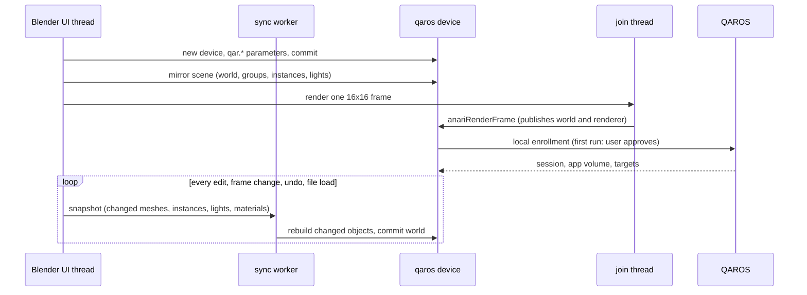

# Developing the add-on

## Layout

| Path | Holds |
|---|---|
| `blender/qaros_anari/` | the add-on: the ZIP is this folder |
| `blender/qaros_anari/panel/` | the controls panel page (HTML, CSS, JS) served to headsets |
| `tests/` | unit tests (plain Python), Blender tests (background mode), device tests |
| `tests/usd/` | USD scenes for the USD tests |
| `tools/run_tests.py` | runs the tests, see [Tests](#tests) |
| `tools/build_zip.py` | writes `dist/qaros_anari.zip` |
| `tools/blender_material_validation.py` | live material reference scene for checking a backend by eye |
| `tools/prepare_blender_addon.py` | adds `qaros` to the library list of Khronos's `CustomAnariRender.py` render engine |

## Dependencies on QAROS

The add-on ships no native code. It loads, through `ctypes`:

| Library | From | Used for |
|---|---|---|
| `anari.dll`, `anari_library_qaros.dll` | QAROS setup, `anari\` (on the system `PATH`), or **ANARI folder** | the scene: device, objects, materials, lights, `qar.*` parameters |
| the QAR runtime (`qar-streaming-c`) | the path the device reports (`qar.runtimeLibrary`) | controls panel, gestures, on the device's own session |

- The C structures in `panel.py` and `pointing.py` follow the public C API header
  `qar_streaming.h` ([qaros](https://github.com/Quaternar/qaros)). That API only grows, so an add-on
  works with every newer QAROS; a feature the installed QAROS lacks is reported and left out.
- `qar.*` device parameters and backends are documented with the device in QAROS.

## How it works



- **Not a render engine.** Blender frees a viewport engine on Solid shading or a closed 3D view.
  The add-on owns one device from Start to Stop and mirrors the scene from depsgraph handlers.
- **Publish once.** The device streams the world of the app's last rendered frame, so the add-on
  renders one small frame; later edits commit on the same world.
- **No ANARI calls on the UI thread.** The UI thread reads the depsgraph into numpy snapshots
  (`SceneCapture`); one worker applies them (`SceneMirror`, `SyncWorker`). A waiting snapshot
  absorbs the next, so a drag sends the latest transforms.
- **Incremental.** Only changed objects are rebuilt; moved instances get a new transform in place.
- **Batching.** Static parts of one material are merged into chunks; a moving object leaves its
  chunk and rejoins after 2 s still.
- **Culling.** Objects entirely outside the app volume (`qar.volumeCube`) are left out.
- **Lights** stream in the units Cycles renders them with; a scene without lights gets a sun.
- **Materials:** constant inputs of the active Principled BSDF (`materials.py`); the device's
  advertised capabilities decide what each backend gets.
- **Controls panel** (`panel.py`, `controls.py`, `protocol.py`, `blender_panels.py`): the page is
  served over the device's session. Edits are queued per control on the QAR thread and applied by
  the UI thread every 50 ms, latest value first; a released drag is one undo step. The panel keeps
  its id across runs (common name per app volume), so every run points it at its own bundle again:
  a panel an earlier run left would otherwise name a publisher that is gone and stay blank.
- **Pointing** (`pointing.py`): a click selects by Blender's ray cast and switches that user's
  one-hand drag to the object. The ray cast reports a collection instance as its prototype; the
  pick maps it to the instancing object through the depsgraph's instances (matched by matrix), so
  a drag never moves the prototype inside every instance.
- **Stop from QAROS** (`hub_launch.py`): a QAROS launcher stops an app by closing its stdin, asking
  it to close and terminating it one second later. When QAROS started Blender (`QAR_INSTANCE` set,
  stdin a pipe), the add-on watches stdin and quits Blender at once; Blender writes `quit.blend`
  first. A Blender started by hand never quits on its own.

## Developing against a hub from a QAROS build

Start Blender from that hub's Visualizer (**Sources → + Add source app → QAROS API app**,
`blender.exe`), never by hand. Its launcher hands Blender the hub's `QAR_INSTANCE`, so the add-on
joins that hub. A Blender started by hand finds and starts the installed QAROS instead.

Point **ANARI folder** at the build's device output folder to test a device build.

## Tests

```powershell
python tools/run_tests.py                                   # every group whose needs are met
python tools/run_tests.py --group unit                      # plain Python only
python tools/run_tests.py --anari-folder <build>\qar-anari-device\bin --backend visgl
```

- `unit` runs everywhere. `blender` needs Blender (found on `PATH` or in Program Files, or
  `--blender`). `device` also needs a device folder: the installed QAROS's `anari` folder by
  default.
- Device tests run with streaming off (`QAR_ANARI_STREAM=0`) on `--backend` (default `helide`). A
  test exits 77 (skipped) when the backend cannot run on this PC, for example VisGL without
  hardware OpenGL.
- `test_blender_usd_scene.py` renders `tests/usd/usd_scene.usda` and checks each object by the colour
  where it lands, so a lost material, opacity, instance or light shows as a wrong pixel.
- `test_blender_addon_sync.py SceneSyncTests.<method>` runs one material case.

## Releasing

1. Update `bl_info["version"]` in `blender/qaros_anari/__init__.py` and move `Unreleased` in
   `CHANGELOG.md` under that version.
2. Tag `vX.Y.Z` and push the tag. CI builds `qaros_anari.zip` and attaches it to a GitHub release.

## Commits

- Subject `area: what changed` (Conventional Commits), body terse bullets.
- A user-visible change gets its `Unreleased` entry in `CHANGELOG.md` in the same commit.
