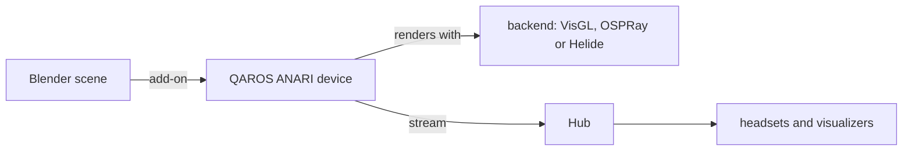

# Blender user guide

The **QAROS ANARI Streaming** add-on streams the scene open in Blender into an app volume, live, to every headset and visualizer in the session. You keep working in Blender as usual: moving an object, editing a mesh or changing a material shows up in the room within a moment. Blender's own viewport and renderers are not involved; the picture comes from an [ANARI](https://www.khronos.org/anari/) renderer (the *backend*) that QAROS runs inside Blender.

## Requirements

| What | Needed |
|---|---|
| QAROS | installed with the **ANARI device** component (setup section **ANARI applications**, or `/ANARI`; see [Installation](https://docs.quaternar.com/docs/operator-guide/installation))) |
| OSPRay backend | optional: the setup's **OSPRay backend (CPU)** section (`/OSPRay`) |
| Blender | 4.5 LTS or newer, on the QAROS PC (Windows) |
| GPU | OpenGL 4.3 for the VisGL backend; the CPU backends need none |

## Set up

1. Install the add-on, one of:
   - **QAROS Visualizer:** the **Blender** tile in Source Applications downloads the latest release of the add-on and starts Blender with it (see [Start Blender from QAROS](#start-blender-from-qaros)).
   - **Install from Disk:** download `qaros_blender_anari-<version>.zip` from this repository's [latest release](https://github.com/Quaternar/qaros-blender/releases/latest) and install it in Blender: **Edit → Preferences → Add-ons**, then **Install from Disk** and pick the ZIP. Enable **QAROS ANARI Streaming**. To update, install a newer ZIP the same way.
2. Leave **ANARI folder** in the add-on's preferences empty: the add-on then uses the ANARI device QAROS installed.
3. Optionally choose a **Backend** (see [Backends](#backends)). **Automatic** is right for most PCs.

## Stream a scene

1. In the 3D View, open the sidebar (`N`) and its **QAROS** tab.
2. Optionally type an **App volume** name (see [App volume](#app-volume)).
3. Click **Start streaming**.
4. The first time, QAROS asks **"Allow Blender to join QAROS?"**: check the publisher and path, then click **Allow** (see [Approved local apps](https://docs.quaternar.com/docs/operator-guide/source-applications#approved-local-apps)). Later starts join at once.
5. The scene appears in its app volume. Click **Stop streaming** to end it; Blender keeps running.

While streaming, the **QAROS** tab shows:

| Line | Meaning |
|---|---|
| status | joining, streaming, or why it stopped |
| **Backend:** | the backend actually rendering |
| **Restart Blender to use …** | the Backend preference names another backend than the one loaded |
| objects, triangles | what is being streamed |
| material lines | the loaded backend's material support and any approximation (see [Materials](#materials)) |
| **Streams to** | the devices that get the stream (see [Choose devices](#choose-devices)) |

### Choose devices

By default the scene streams to every device in QAROS: every headset and every receiver of a Visualizer, also those that join later. **Streams to** in the **QAROS** tab narrows that, like **Streams to** of an app in the Visualizer's Source Applications:

1. Start streaming. Once it runs, the tab lists the connected devices, each with a checkbox; the list follows devices as they join and leave.
2. Untick a device to stop streaming to it, or untick **All devices** and tick the ones you want. A dot beside a device means it is receiving the stream now.
3. Tick **All devices** to stream to everyone again.

- A change applies at once; no Stop or Start.
- Unticking **All devices** keeps every connected device ticked until you untick one.
- A chosen device that leaves stays in the list as *not connected* and gets the stream again when it comes back.
- Unticking every device streams to nobody; the app volume stays.
- The choice is saved with the `.blend` file, like the **App volume** name. A new scene, and a Blender started from QAROS without a file, streams to every device. A file saved on another QAROS lists its devices as *not connected*.
- **Users** (preferences) is the most devices served at once, 2 by default; the tab warns when more are chosen.
- An older QAROS cannot choose: the tab says so and streams to every device.

### Start Blender from QAROS

The visualizer's **Blender** tile in [Source Applications](https://docs.quaternar.com/docs/operator-guide/source-applications) starts Blender with the add-on enabled, and the add-on clicks **Start streaming** by itself once Blender has loaded (`QAR_BLENDER_AUTO_START=1`). If that start fails, for example because the first-run approval was declined, it is not repeated: click **Start streaming** yourself.

You can also add Blender to the visualizer's [Source Applications](https://docs.quaternar.com/docs/operator-guide/source-applications) and start it from there:

1. Switch the visualizer to the **Developer** UI mode (Settings).
2. **+ Add source app** → **QAROS API app**, **Executable** `blender.exe` (for example `C:\Program Files\Blender Foundation\Blender 4.5\blender.exe`). **Arguments** are passed to Blender, one per line, for example a `.blend` file to open.
3. Launch the new tile, then click **Start streaming** in the add-on.

**Stop** in the visualizer quits that Blender at once, without a save prompt. Blender saves the session to `quit.blend` first: **File → Recover → Last Session** brings unsaved work back. A Blender you started yourself is never closed by QAROS.

## App volume

The scene streams into one app volume. Its name is the **App volume** field in the **QAROS** tab, saved with the `.blend` file.

| Field | Volume |
|---|---|
| empty (default) | **Blender**, or **Blender 2**, **Blender 3**, … when another Blender on this PC already shows one; the tab says which |
| a name | that volume only; if another Blender already shows it, streaming does not start and the tab asks for another name |

Change the name while stopped: **Stop streaming**, edit, **Start streaming**. Move, rotate and scale the volume like any other app volume.

**Moving the content is a view change.** Moving, turning or scaling the scene in its volume (gestures in a headset, the Visualizer's mouse, **Fit scene to volume**) moves every user's camera over the scene: Blender's objects, and so its file and undo history, stay as they are. Only edits made on purpose change the scene: the panel's sliders, and a drag that grabs the object you selected (below).

- **Placement:** the world origin of the scene sits at the centre of the app volume. Blender's Z-up becomes the room's up. **Fit scene to volume** (QAROS tab) places and scales the scene to fill the volume instead; it is not repeated when the scene changes.
- **Size:** **Scale** (preferences) is room metres per Blender unit, 0.25 by default: a 4 m Blender scene fills a 1 m volume. It applies when the volume is first created. A volume that already exists keeps its own scale and position, including changes made in the room, across Blender restarts; to start over with the preference, stream into a new **App volume** name.
- **Outside the volume:** objects whose bounds lie entirely outside the app volume are not streamed. They come back as soon as the volume moves or grows to include them.

## Controls panel in the headset

While streaming, every user sees a **Blender** panel beside the app volume. It edits the **active** object:

| Tab | Edits |
|---|---|
| **Object** | location, rotation (degrees), scale |
| **Material** | Principled base colour, roughness, metallic |
| **Frame** | current frame, play |
| **Panels** | Blender's own panels (Transform, Relations, Visibility by default), with Blender's labels and limits |

- Undo and redo buttons on the panel; a released slider drag is one undo step in Blender.
- Name, Parent and Parent Bone are typed on the headset's virtual keyboard; file paths stay read-only.
- Several users editing the same value: the last edit wins.
- **Show in the headset** in the QAROS tab hides or shows the panel. Which tabs and which Blender panels it offers is set in the add-on's preferences (**Controls panel in the headset**); a hidden tab's edits are refused.
- When QAROS cannot show the panel, streaming goes on without it and the tab says **No controls panel**.

### Pointing into the volume

| Gesture | Effect |
|---|---|
| Click an object | selects it and makes it active. A child moves in world space and keeps its parent; a collection instance selects and moves the object that instances it |
| One-hand drag that grabs your selected object | moves that object in Blender |
| One-hand drag anywhere else (empty space, another object, a panel's title bar) | pans the view (the scene in its volume); Blender's objects stay put |
| Two hands apart or together, with an object selected | scales that object about its origin |
| Two hands turning, with an object selected | turns that object about its origin, around the vertical |
| Two hands apart or together, or turning, with nothing selected | zooms or turns the view about the volume's centre |
| Click empty space | clears your selection |

- Blender decides what each gesture does, when it starts. **Hand gestures** in the add-on's
  preferences: **Selected object, else view** (the table above), or **View only** (every gesture
  moves the view).

- Your ray decides: while it rests on your selected object, a pinch grabs the object; once a hover
  shows it elsewhere in the volume, a pinch moves the view. A pinch that grabs nothing in the
  volume (on a panel's title bar, say) never moves an object.
- Moving a panel never moves the scene in Blender: panels stay where you put them, beside the
  volume when they first open.

## USD files

Use **File → Import → USD for QAROS (.usd\*)**. It runs Blender's USD import with **Import All Materials** and corrects what that import leaves out of the stream:

- primitive shapes (sphere, cube, cylinder, cone, capsule, plane) get the material bound to them;
- preview-surface opacity becomes **Alpha**, not transmission;
- sphere light radii are scaled with the stage's units;
- materials nothing uses are removed.

Blender's own **File → Import → Universal Scene Description** gets the first two corrections too, while the add-on is enabled. Faces without a material stream their colour attribute (for example USD `displayColor`).

## Backends

| Backend | Runs on | Look | Speed in a headset | Use it for |
|---|---|---|---|---|
| **VisGL** | GPU (OpenGL 4.3) | lit, with shadows; colour, metallic, roughness, emission, transparency | 30 fps for scenes of thousands of objects | headsets: the default choice |
| **OSPRay** (Intel) | CPU | flat shading with hard shadows; colour and transparency only | about 20 fps for a scene that fills the view | PCs without a usable GPU |
| **Helide** | CPU | simple reference shading; no transparency | a few fps | checking a result against a second renderer |
| **VisRTX** (NVIDIA, where installed) | NVIDIA RTX GPU | ray traced, with shadows; metallic, roughness and emission with grain in a moving view, or smooth matte (**VisRTX materials**) | 30 fps for the cube scene | comparing with a ray tracer |

- **Automatic** (default) uses the first of VisGL, VisRTX, OSPRay and Helide that starts on this PC: VisGL first, for its physically based materials without grain. A QAROS whose ANARI device does not know this order yet starts with VisRTX instead; choose **VisGL** to be sure.
- The CPU backends render at half the headset's resolution per side by default and are upscaled; see **Render scale** below.
- A stream that keeps every CPU core busy runs on OSPRay or Helide, not on VisGL: check the **Backend:** line.
- **Backend** and **ANARI folder** take effect only when Blender restarts. The tab says when the loaded backend differs from the preference.

## Preferences

**Edit → Preferences → Add-ons → QAROS ANARI Streaming**:

| Setting | Default | Meaning | Applies |
|---|---|---|---|
| **ANARI folder** | empty | folder with `anari.dll` and `anari_library_qaros.dll`; empty uses the ANARI device of the QAROS that started Blender, else the installed one on the system `PATH` | after a Blender restart |
| **Backend** | Automatic | the renderer, see [Backends](#backends) | after a Blender restart |
| **Users** | 2 | how many headsets and visualizers can watch at once | next start |
| **Frame rate** | 30 | stereo pairs per second per user | next start |
| **Render scale** | 0 | share of the headset's resolution each eye renders at, upscaled for the headset: 0 is automatic (half on OSPRay and Helide, full on VisGL), otherwise 0.25 to 1. Below full resolution the status ends with the share in use, for example "at 50 % resolution" | next start |
| **Scale** | 0.25 | room metres per Blender unit | when the app volume is created ([App volume](#app-volume)) |
| **Near**, **Far** | 0.1, 100 | depth range in Blender units; content outside it is not drawn | next start |
| **Ambient light** | 0.3 | constant light on faces that no lamp reaches | next start |
| **VisRTX materials** | Physically based (metal, grain) | on VisRTX: **Physically based** shows metal, highlights and emission, with grain on faces lit by the ambient light in a moving view; **Matte (smooth)** streams colour only, without grain | next start |
| **Controls panel in the headset** | every tab; Transform, Relations, Visibility | which tabs the [controls panel](#controls-panel-in-the-headset) shows, and the Blender panels on its **Panels** tab (**Default panels** restores them) | at once |

## Materials

The add-on streams each material's **Principled BSDF** that feeds **Surface** on the active **Material Output** (target **All**); reroutes in between are fine. Only the inputs' constant values are read.

| Principled input | Streamed as | When linked to a node or texture |
|---|---|---|
| **Base Color** | surface colour | the material's viewport colour |
| **Metallic** | metalness | non-metallic |
| **Roughness** | roughness | 0.5 |
| **Alpha** | transparency (coverage) | opaque |
| **Emission Color** × **Emission Strength** | self-illumination | no emission |

What each backend shows:

| | VisGL | OSPRay | Helide | VisRTX |
|---|---|---|---|---|
| Base Color | yes | yes | yes | yes |
| Metallic, Roughness, Emission | yes | no (matte) | yes | yes, or no with **VisRTX materials** Matte |
| Alpha | yes | yes | no (opaque) | yes |

- **Material with nodes off,** or a shader other than a Principled BSDF (mix shaders, groups): the viewport display colour and alpha, with a note in the tab.
- **Lights:** a sun stays a sun; point, spot and area lamps become point lights. A scene without lamps gets one sun. **Ambient light** lights the faces lamps miss.
- **World:** an **Environment Texture** (equirectangular image, for example an HDRI) on the World's **Background**, with its **Strength** and the rotation of a **Mapping** node, or the Background's plain colour, becomes an environment light that lights and reflects in the scene without being drawn behind it. Only a backend that can light with an environment it does not draw gets it; today none of the shipped ones can (VisGL has no environment light, OSPRay's streaming renderer ignores it, VisRTX draws it behind the scene), so metal reflects only the lamps and the ambient light. The World is then left out without a message; the console says `world: not streamed`.
- **Not streamed:** image and procedural textures, vertex colours, normal and bump maps, transmission and glass, coat, sheen, subsurface and the other advanced Principled inputs.
- Shading follows the backend, so the picture does not match Blender's viewport, EEVEE or Cycles exactly.

## Troubleshooting

| What you see | Do this |
|---|---|
| Nothing happens after **Start streaming** | Answer the **Allow Blender to join QAROS?** prompt (tray window, or the visualizer's **Source Applications** panel). An unanswered prompt expires after 120 s. |
| Start fails, no backend loads | Check that QAROS was installed with the **ANARI device** component and leave **ANARI folder** empty. Restart Blender after changing it. |
| The stream is slow and all CPU cores are busy | The scene runs on OSPRay or Helide. Choose **VisGL** under **Backend** and restart Blender. |
| Metallic, roughness or emission have no effect | The tab says **Backend uses a matte approximation** (OSPRay, or VisRTX with **VisRTX materials** Matte). Use VisGL, or set **VisRTX materials** to Physically based. |
| Metal looks matte compared with Blender's viewport | Blender's **Material Preview** lights metal with a studio HDRI; the stream has no environment to reflect. Add lamps where the reflections should come from. |
| Grain on VisRTX | Physically based materials on VisRTX sample the ambient light at random. Set **VisRTX materials** to Matte, or use VisGL. |
| Editing a Principled node changes nothing | Make sure it feeds **Surface** of the active **Material Output** (target **All**); unconnected nodes are ignored. Set the value directly on the node instead of linking it. |
| A colour turns into the viewport colour | The input is linked to a node or texture. Set a constant value. |
| Alpha stays opaque | The tab says **Backend lacks alpha blending** (Helide). Use VisGL or OSPRay. |
| Part of the scene is missing | It lies outside the app volume or beyond **Far**. Move or scale the volume, or change **Scale** or **Far**. |
| The scene is tiny or huge | The app volume kept the scale it had from earlier. Stream into a new **App volume** name after setting **Scale** (room metres per Blender unit). |
| A headset or Visualizer receiver shows nothing | **Streams to** in the QAROS tab: tick the device, or **All devices**. With more devices than **Users** (preferences), only that many get the stream. |
| **'…' is already shown by another Blender** | Another Blender streams into that volume. Choose another **App volume** name, or leave it empty. |

## Limitations

- **Whole objects:** an object partly outside the app volume is streamed whole; one large mesh around the viewer is never left out.
- **Large edits cost time in Blender:** a changed object is sent again in full, so editing a very large mesh is slower while streaming.
- **Moving many objects at once is slower:** objects in motion are drawn one by one until they rest for about 2 s.
- **Geometry:** meshes, and curves and volumes as far as they convert to a mesh.
- **Gaussian splats and point clouds are not streamed.** This covers point cloud and Gaussian splat objects (Blender 5.3 and later) and meshes with vertices but no faces, such as a 3DGS PLY imported as loose vertices in Blender 5.2 or earlier. The tab lists each as **'name': Gaussian splats and point clouds are not streamed** (**'name': has no faces: not streamed** for other meshes without faces), and the same line is written once per object to Blender's console as `[qaros-anari] ...`. **Fit scene to volume** leaves them out, so it frames only what is streamed.
- **One app volume per Blender,** placed at the scene's world origin; no camera, collection or origin object is used to place it.
- Windows only.
